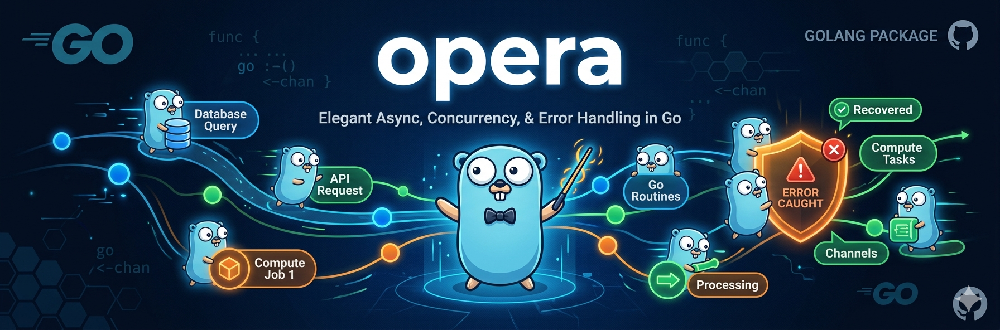

# opera

[](https://go.dev/doc/devel/release)
[](https://github.com/ColaFanta/go-opera/actions/workflows/unit-test.yml)
[](https://pkg.go.dev/github.com/colafanta/go-opera)
[](LICENCE)



`opera` brings `Option`, `Result`, fail-fast `Do`, and context-aware async helpers to Go. It is designed for code that needs explicit absence and error handling without repeatedly expanding `(value, error)` checks or coordinating goroutines and result channels by hand.

## Features

- **`Option[T]`** represents a value that may be absent, with constructors for maps, slices, pointers, empty values, and casts.
- **`Result[T]`** represents either a value or an error and provides transformation and recovery helpers.
- **`Do` notation** enables concise fail-fast code: `Result.Yield()` and `Option.Yield()` return control to `Do` as an error.
- **`Async` helpers** run context-aware work and await one, all, or the first successful result.
- **Workflows and resource helpers** support compensating finalizers and scoped resource cleanup.

## Agent Skills

See the [categorized skills](./skills/index.md) for package usage and safe legacy
Go migrations: Result flow, optional values, async coordination, and resource
workflows. Each category has a `SKILL.md` entry point and focused references with
replacement patterns, equivalence conditions, and cases to leave unchanged.
The index also explains how to enable skill discovery in a consuming project.

## Install

```sh
go get github.com/colafanta/go-opera
```

```go
import opera "github.com/colafanta/go-opera"
```

## Quick Start

Use `Option` for a value that may not exist. `Get` keeps the normal Go `value, ok` shape, while `Or` supplies a fallback.

```go
config := map[string]int{"port": 8080}
port := opera.MayLookUp(config, "port").Or(3000)
// port == 8080
```

Use `Result` to compose operations that can fail.

```go
address := opera.Ok(8080).
	Map(func(port int) string { return fmt.Sprintf("localhost:%d", port) })

value, err := address.Get()
// value == "localhost:8080", err == nil
```

## Error Handling With `Do`

`Do` converts a failure yielded from `Result` or `Option` into a `Result`. Inside the callback, use `Yield` to unwrap a successful value. The first yielded error stops the callback and becomes the returned `Result` error.

```go
func readPort(config map[string]string) (int, error) {
	return opera.Do(func() int {
		portText := opera.MustLookUp(config, "port")
		port, err := strconv.Atoi(portText)
		return opera.Must(port, err)
	}).Get()
}
```

Errors can be recovered selectively after the `Do` block.

```go
port := opera.Do(func() int {
	return opera.MustLookUp(map[string]int{}, "port")
}).CatchIs(opera.ErrNoSuchElement, 3000).OrEmpty()
// port == 3000
```

`Yield` is intended for `Do` notation. For ordinary control flow, prefer `Get`, `Err`, `Or`, or `OrEmpty`; use `OrPanic` only when a panic is deliberately appropriate.

## Structured Concurrency With `Async`

`Async` accepts a `context.Context` and returns a buffered channel of `Result[T]`. Awaiting helpers propagate context cancellation and avoid manual channel plumbing.

```go
func loadPorts(ctx context.Context) ([]int, error) {
	primary := opera.Async(ctx, func(context.Context) opera.Result[int] {
		return opera.Ok(8080)
	})
	metrics := opera.Async(ctx, func(context.Context) opera.Result[int] {
		return opera.Ok(9090)
	})

	return opera.AwaitAllT(ctx, primary, metrics).Get()
}
```

Use `AwaitAll` for heterogeneous task values, `AwaitAllT` for homogeneous task values, `AwaitFirst` for the first successful result, and `AwaitAllSettled` when every success and failure is needed.

## Documentation And Examples

Each API entry below has a direct link to its reference documentation and, where available, a link to the rendered Go example on `pkg.go.dev`. The examples are executable tests in this repository, so they are checked by `go test` as well as displayed in the package documentation.

### `Option[T]`

An `Option` is either `Some(value)` or `None`. It is useful for optional configuration, map lookups, slice access, nullable pointers, and safe type assertions.

| API | Description | Links |
| --- | --- | --- |
| `Some` | Create an option containing a value. | [docs](https://pkg.go.dev/github.com/colafanta/go-opera#Some) · [example](https://pkg.go.dev/github.com/colafanta/go-opera#example-Some) |
| `None` | Create an absent option. | [docs](https://pkg.go.dev/github.com/colafanta/go-opera#None) · [example](https://pkg.go.dev/github.com/colafanta/go-opera#example-None) |
| `MayLookUp` | Turn a map lookup into an option. | [docs](https://pkg.go.dev/github.com/colafanta/go-opera#MayLookUp) · [example](https://pkg.go.dev/github.com/colafanta/go-opera#example-MayLookUp) |
| `MayAt` | Safely access a slice element by index. | [docs](https://pkg.go.dev/github.com/colafanta/go-opera#MayAt) · [example](https://pkg.go.dev/github.com/colafanta/go-opera#example-MayAt) |
| `MaybeNilPtr` | Convert a possibly nil pointer into an option. | [docs](https://pkg.go.dev/github.com/colafanta/go-opera#MaybeNilPtr) · [example](https://pkg.go.dev/github.com/colafanta/go-opera#example-MaybeNilPtr) |
| `Option.Get` | Return the value and its presence flag. | [docs](https://pkg.go.dev/github.com/colafanta/go-opera#Option.Get) · [example](https://pkg.go.dev/github.com/colafanta/go-opera#example-Option.Get) |
| `Option.Map` | Transform a present value. | [docs](https://pkg.go.dev/github.com/colafanta/go-opera#Option.Map) · [example](https://pkg.go.dev/github.com/colafanta/go-opera#example-Option.Map) |
| `Option.FlatMap` | Chain an operation returning another option. | [docs](https://pkg.go.dev/github.com/colafanta/go-opera#Option.FlatMap) · [example](https://pkg.go.dev/github.com/colafanta/go-opera#example-Option.FlatMap) |
| `Option.ToResult` | Convert absence to `ErrNoSuchElement`. | [docs](https://pkg.go.dev/github.com/colafanta/go-opera#Option.ToResult) · [example](https://pkg.go.dev/github.com/colafanta/go-opera#example-Option.ToResult) |

### `Result[T]` And `Do`

A `Result` is either `Ok(value)` or `Err(error)`. It retains a partial value passed to `Try` even when an error is present; retrieve that pair with `Get` when it is meaningful to the caller.

| API | Description | Links |
| --- | --- | --- |
| `Ok` / `Err` | Create successful or failed results. | [Ok docs](https://pkg.go.dev/github.com/colafanta/go-opera#Ok) · [Ok example](https://pkg.go.dev/github.com/colafanta/go-opera#example-Ok) · [Err docs](https://pkg.go.dev/github.com/colafanta/go-opera#Err) · [Err example](https://pkg.go.dev/github.com/colafanta/go-opera#example-Err) |
| `Try` | Wrap a standard `(value, error)` result. | [docs](https://pkg.go.dev/github.com/colafanta/go-opera#Try) · [example](https://pkg.go.dev/github.com/colafanta/go-opera#example-Try) |
| `Do` | Capture errors yielded within a callback. | [docs](https://pkg.go.dev/github.com/colafanta/go-opera#Do) · [example](https://pkg.go.dev/github.com/colafanta/go-opera#example-Do) |
| `Must` | Yield a standard `(value, error)` pair inside `Do`. | [docs](https://pkg.go.dev/github.com/colafanta/go-opera#Must) · [example](https://pkg.go.dev/github.com/colafanta/go-opera#example-Must) |
| `Result.Get` | Return the value and error. | [docs](https://pkg.go.dev/github.com/colafanta/go-opera#Result.Get) · [example](https://pkg.go.dev/github.com/colafanta/go-opera#example-Result.Get) |
| `Result.Map` / `FlatMap` | Transform successful values. | [Map docs](https://pkg.go.dev/github.com/colafanta/go-opera#Result.Map) · [Map example](https://pkg.go.dev/github.com/colafanta/go-opera#example-Result.Map) · [FlatMap docs](https://pkg.go.dev/github.com/colafanta/go-opera#Result.FlatMap) · [FlatMap example](https://pkg.go.dev/github.com/colafanta/go-opera#example-Result.FlatMap) |
| `Result.CatchIs` | Recover from an error matched with `errors.Is`. | [docs](https://pkg.go.dev/github.com/colafanta/go-opera#Result.CatchIs) · [example](https://pkg.go.dev/github.com/colafanta/go-opera#example-Result.CatchIs) |
| `Scoped` | Acquire, use, and release a resource. | [docs](https://pkg.go.dev/github.com/colafanta/go-opera#Scoped) · [example](https://pkg.go.dev/github.com/colafanta/go-opera#example-Scoped) |

### Async

| API | Description | Links |
| --- | --- | --- |
| `Async` | Run a `Result`-producing task in a goroutine. | [docs](https://pkg.go.dev/github.com/colafanta/go-opera#Async) · [example](https://pkg.go.dev/github.com/colafanta/go-opera#example-Async) |
| `Await` | Wait for one task. | [docs](https://pkg.go.dev/github.com/colafanta/go-opera#Await) · [example](https://pkg.go.dev/github.com/colafanta/go-opera#example-Await) |
| `AwaitAll` | Wait for heterogeneous tasks. | [docs](https://pkg.go.dev/github.com/colafanta/go-opera#AwaitAll) · [example](https://pkg.go.dev/github.com/colafanta/go-opera#example-AwaitAll) |
| `AwaitAllT` | Wait for homogeneous tasks with type safety. | [docs](https://pkg.go.dev/github.com/colafanta/go-opera#AwaitAllT) · [example](https://pkg.go.dev/github.com/colafanta/go-opera#example-AwaitAllT) |
| `AwaitFirst` | Return the first successful task and its index. | [docs](https://pkg.go.dev/github.com/colafanta/go-opera#AwaitFirst) · [example](https://pkg.go.dev/github.com/colafanta/go-opera#example-AwaitFirst) |
| `AwaitAllSettled` | Collect every result, including failures. | [docs](https://pkg.go.dev/github.com/colafanta/go-opera#AwaitAllSettled) |
| `AwaitZip` | Await heterogeneous tasks as a typed tuple. | [docs](https://pkg.go.dev/github.com/colafanta/go-opera#AwaitZip) |

### Workflows And Utilities

| API | Description | Links |
| --- | --- | --- |
| `Workflow` / `Step` / `Finalize` | Register finalizers and run them in reverse order when a workflow succeeds or fails. | [Workflow docs](https://pkg.go.dev/github.com/colafanta/go-opera#Workflow) · [Step docs](https://pkg.go.dev/github.com/colafanta/go-opera#Step) · [Finalize docs](https://pkg.go.dev/github.com/colafanta/go-opera#Finalize) |
| `Suspend` | Convert context-aware functions into deferred async thunks. | [docs](https://pkg.go.dev/github.com/colafanta/go-opera#Suspend) |
| `Empty` / `IsEmpty` | Work with the empty value of a type. | [Empty docs](https://pkg.go.dev/github.com/colafanta/go-opera#Empty) · [Empty example](https://pkg.go.dev/github.com/colafanta/go-opera#example-Empty) · [IsEmpty docs](https://pkg.go.dev/github.com/colafanta/go-opera#IsEmpty) · [IsEmpty example](https://pkg.go.dev/github.com/colafanta/go-opera#example-IsEmpty) |
| `Tup` | Create a typed two-value tuple. | [docs](https://pkg.go.dev/github.com/colafanta/go-opera#Tup) |

For the complete API, including JSON, text, binary, Gob, SQL, tuple, suspend, and async zip helpers, see the [package documentation](https://pkg.go.dev/github.com/colafanta/go-opera).

## Further Reading

- [Effective error handling in Go with Rust-like Result and "?"](https://dev.to/colafanta/guide-to-go-opera-better-error-handling-in-go-but-less-boilerplate-2hf4)
- [Why FlatMap Isn't Ideal for Go Error Handling - A Case for go-opera](https://dev.to/colafanta/go-error-handling-why-flatmap-not-helpful-go-opera-1j25)
- [Async/Await-like pattern in Go to make concurrency simple, robust, less boilerplate](https://dev.to/colafanta/asyncawait-like-pattern-in-go-to-make-structured-concurrency-easy-and-with-less-boilerplate-121l)

## Performance

`Do` uses panic and recovery internally to provide fail-fast control flow, which adds a small allocation and latency cost compared with direct error handling. Benchmark the paths that matter to your application before choosing it for a hot loop.

```text
BenchmarkDoAndGet/ErrFromGet-16    6267090    188.3 ns/op    128 B/op    3 allocs/op
BenchmarkDoAndGet/ErrFromDo-16     6167328    196.9 ns/op    128 B/op    3 allocs/op
```

## Development

```sh
go test ./...
```

## License

This project is licensed under the [MIT License](LICENCE).

## Acknowledgments

`opera` is inspired by [eh](https://github.com/olevski/eh), which introduced Rust-like error handling ideas in Go, and [mo](https://github.com/samber/mo), from which the `Do` notation and `Option` marshaling approach were adapted.